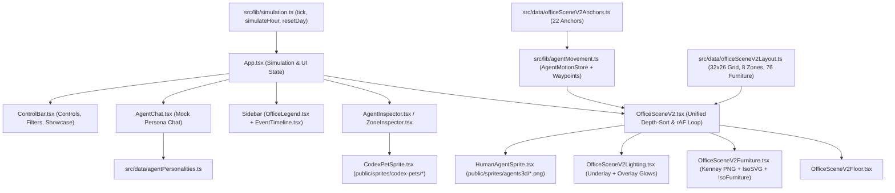

# Agent Office World

**An interactive 2:1 isometric visual operating environment for exploring how specialized AI agent roles coordinate work inside one shared organization.**

[Live portfolio demo](https://agent-office-world.vercel.app) · [Jovan Franco](https://www.jovanfranco.com)

> **Classification:** Interactive concept demonstrator (`NON_PORTFOLIO_SAAS_EXEMPT` under Aloria's portfolio register). The current simulation runs locally in the browser using rule-based transitions, `Math.random()`, and the browser wall clock; it does **not** call an LLM, connect to a backend, execute autonomous work, or process production data.

---

## 1. Product Overview & Purpose

Agent Office World translates an abstract multi-agent operating model into a single, inspectable isometric office workspace. Instead of representing AI agents as isolated chat threads, node graphs, or static org charts, it places **21 specialized agents across 20 roles** inside one shared office floor where they move along corridor waypoints, occupy role-appropriate workstations, converse in character, and emit simulated operational events.

## 2. Problem Solved

Multi-agent architectures are often hard to explain to executives, product teams, and stakeholders because agent coordination happens invisibly behind logs or disconnected prompt cards. Agent Office World provides:

- Spatial legibility: clear functional zones (engineering, command center, strategy/meeting room, research & QA, finance & legal, reception, open workspace, break area).
- Visible operational state: 10 agent states (`Focused`, `Thinking`, `In Meeting`, `Reviewing`, `Blocked`, `Shipping`, `Idle`, `Escalating`, `Learning`, `Collaborating`) mapped to animations, monitor glow overlays, energy levels, and timeline events.
- Safe evaluation without infrastructure overhead: demonstrates multi-agent UX, role taxonomy, and inspection surfaces in a self-contained Vite + React SPA without API keys, model costs, or autonomous side effects.

---

## 3. Implemented Capabilities (Verified in Code)

| Capability | Verified Codebase Evidence |
| --- | --- |
| **Isometric V2/V3 Scene** | `src/components/OfficeSceneV2.tsx`, `src/data/officeSceneV2Layout.ts`: **32×26** grid (`V2_GRID`), **8 rendered zones** (`V2_ZONES`), **76 furniture items** (`V2_FURNITURE`), unified back-to-front painter's depth sort interleaving furniture and agents. |
| **3D Human Agent Sprites** | `src/components/HumanAgentSprite.tsx`: renders all **21 agents** (`src/data/agents.ts`) using **297 PNG frames** under `public/sprites/agents3d/` (6 idle frames, 8 walk frames per agent at ~9 fps / `110ms` interval, generated via `scripts/blender_chars/generate_chars.py`). |
| **Hybrid Furniture & Lighting** | `src/components/OfficeSceneV2Floor.tsx` (warm polished-concrete floor + zone tints), `src/components/OfficeSceneV2Furniture.tsx` (Kenney CC0 PNG sprites via `src/data/officeSpriteMap.ts`, custom 3D-faceted SVG pieces in `src/components/iso/IsoSVG.tsx`, CSS fallbacks in `src/components/iso/IsoFurniture.tsx`), and `src/components/OfficeSceneV2Lighting.tsx` (zone ceiling spotlights + command-center reflection + per-agent pulsing monitor glow). |
| **Smooth Movement & Anchors** | `src/lib/agentMovement.ts` (`AgentMotionStore` with `requestAnimationFrame`, `easeInOutCubic` interpolation, corridor waypoint routing) and `src/data/officeSceneV2Anchors.ts` (**22 anchors** across the 8 V2 zones). |
| **Local Simulation Engine** | `src/lib/simulation.ts`: `tick()`, `simulateHour()`, `resetDay()`, `initialSnapshot()` driving state transitions, task rotation, energy drift/recovery, and capped 40-item event history (`src/data/events.ts`). |
| **Interactive Controls & Filters** | `src/components/ControlBar.tsx`: `Simulate 1 Hour`, `Start Live Mode` / `Pause` (`2200ms` interval), `Reset Day`, role filter (20 roles), state filter (10 states), floating label toggle, and `Showcase` mode (collapses sidebar + hides labels + increases viewport fill). |
| **Agent & Zone Inspectors** | `src/components/AgentInspector.tsx` (displays role, state, task, energy bar, anchor, grid position, next action, and a `CodexPetSprite` preview from `public/sprites/codex-pets/`) and `src/components/ZoneInspector.tsx` (zone details and occupant list). |
| **In-Character Agent Chat & Chatter** | `src/components/AgentChat.tsx` and `src/data/agentPersonalities.ts`: per-agent personas, traits, catchphrases, simulated typing delay, rule/keyword-based `generateResponse()`, and autonomous `generateChatter()` events during Live Mode. |
| **Sidebar Legend & Timeline** | `src/components/OfficeLegend.tsx` (active/blocked counts, zone selector, role color chips) and `src/components/EventTimeline.tsx`. |
| **Query-Param Modes** | `src/App.tsx`: `?autoplay=1` starts Live Mode automatically on load; `?compose=1` renders `src/components/ComposeTest.tsx` (sprite/furniture composition harness). |

### Active V2 Zones vs. Legacy V1 Artifacts

The active application entry (`src/App.tsx`) mounts `OfficeSceneV2`, which renders **8 zones** on a **32×26** grid:
`Meeting Room` (`strategy-room`), `Reception` (`reception`), `Engineering` (`engineering-pods`), `Open Workspace` (`open-workspace`), `Research & QA` (`research-library`), `Finance & Legal` (`finance-desk`), `Break Area` (`break-area`), and `Command Center` (`command-center`).

> **Codebase reconciliation note:** Legacy V1 scene modules (`src/components/OfficeWorld.tsx`, `OfficeFloor.tsx`, `FurnitureLayer.tsx`, `MonitorGlow.tsx`, `AgentSprite.tsx`, `src/data/furniture.ts`, `src/data/activityAnchors.ts`) remain in the repository unmounted. `src/components/OfficeLegend.tsx` still reads `OFFICE_ZONES` from `src/data/officeZones.ts` (which lists 12 V1 zones, so 4 legacy zones—`War Room`, `QA Lab`, `Client Success Area`, and `Security Desk`—appear in the sidebar list with `0` active occupants).

---

## 4. Features in Development / Pending

- **Real LLM & Agent Telemetry Integration (`NOT_STARTED`):** Replacing `generateResponse()` (`src/data/agentPersonalities.ts`) and `tick()` (`src/lib/simulation.ts`) with live model inference, authenticated telemetry streams, durable event storage, and server-side authorization.
- **Automated Unit / E2E Test Suite (`NOT_STARTED`):** Adding component, simulation, and browser regression tests (only a manual/ad-hoc audit runner script `audit/agent-office-p2-execution-runner.mjs` currently exists).
- **Legend/Zone Catalog Consolidation (`PARTIALLY_IMPLEMENTED`):** Aligning `OfficeLegend.tsx` and `ZoneInspector.tsx` strictly with `V2_ZONES` (8 zones) rather than legacy `OFFICE_ZONES` (12 zones), and retiring or archiving unused V1 scene files.
- **Commercial Asset Clearance (`BLOCKED_EXTERNAL`):** Resolving per-asset licensing for the 30 bundled Codex Pets sprites (`public/sprites/codex-pets/`) or removing `CodexPetSprite` from `AgentInspector.tsx` before any commercial deployment.

---

## 5. Architecture & Tech Stack

### Stack

- **UI Framework:** React `^18.3.1` + React DOM `^18.3.1` (`src/main.tsx`, `src/App.tsx`)
- **Language & Build:** TypeScript `^5.6.3` (`strict: true`), Vite `^5.4.11` with `@vitejs/plugin-react` `^4.3.4`
- **Styling:** Tailwind CSS v4 (`tailwindcss` `^4.0.0`, `@tailwindcss/vite` `^4.0.0`) + custom CSS (`src/styles.css`) for isometric transforms, keyframes, and scrollbars
- **Asset Pipeline (Offline/Build-time):**
  - `scripts/blender_chars/generate_chars.py` (Blender Cycles script generating `public/sprites/agents3d/*.png`)
  - `scripts/fetch-codex-pets.mjs` (fetches Petdex sprites into `public/sprites/codex-pets/`)
  - Static Kenney CC0 furniture PNGs in `public/sprites/office/` (52 files)

### Component & Simulation Flow



### Isometric Projection

```text
screen.x = (gridX - gridY) * tileWidth / 2
screen.y = (gridX + gridY) * tileHeight / 2
```

Default tile dimensions in `src/lib/isometric.ts` are `64×32` (`DEFAULT_TILE`). `OfficeSceneV2.tsx` merges `V2_FURNITURE` and active agents into one sorted list ordered by `gridX + gridY` (with a `+0.4` depth nudge for agents) so foreground furniture occludes agents standing behind it.

### Simulation Mechanics & Terminology Reconciliation

Earlier portfolio documentation described this app as a `"deterministic simulation"` (`"Deterministic before autonomous"`—meaning fixed local rules without an external LLM or backend). Code inspection and `audit/agent-office-p2-execution-runner.mjs` verify that the simulation is **not** strictly deterministic across runs:

- `src/lib/simulation.ts` uses `Math.random()` for state transitions, task selection, and event selection, and `Date.now()` / `new Date().toLocaleTimeString()` for event IDs and timestamps.
- `src/lib/agentMovement.ts` (`scheduleActivities`) and `src/data/officeSceneV2Anchors.ts` (`pickFreeV2Anchor`) use `Math.random()` for agent selection, destination choice, and activity hold duration.
- `src/App.tsx` uses `Math.random()` to select autonomous chatter agents during Live Mode, and `src/components/AgentChat.tsx` uses `Math.random()` for simulated typing delay.

---

## 6. Integrations & Dependencies

- **Runtime external APIs:** **None.** The browser application makes zero network calls to external APIs, LLMs, or databases at runtime; all sprites and manifests are served locally from `public/`.
- **Build/maintenance external source (CLI only):** `scripts/fetch-codex-pets.mjs` fetches from `https://assets.petdex.dev/curated/<slug>/...` and `https://assets.petdex.dev/manifests/petdex-v1.json` when invoked manually via `npm run fetch-pets`.
- **Bundled third-party & generated assets:**
  - **Kenney Furniture Kit (CC0):** 52 PNGs under `public/sprites/office/`, mapped in `src/data/officeSpriteMap.ts`.
  - **Blender 3D Humanoid Sprites:** 297 PNGs under `public/sprites/agents3d/`, generated offline by `scripts/blender_chars/generate_chars.py`.
  - **Codex Pets / Petdex Sprites:** 30 directories under `public/sprites/codex-pets/`, used in `AgentInspector.tsx` (and legacy `AgentSprite.tsx`). Owned by respective Petdex submitters; **demo/local use only** (see [`docs/codex-pets-usage.md`](docs/codex-pets-usage.md)).

---

## 7. Local Installation & Execution

Prerequisites: Node.js and npm.

```bash
npm install
npm run dev
```

Open `http://localhost:5173`. Optional URL parameters:
- `http://localhost:5173/?autoplay=1` — starts Live Mode automatically on page load.
- `http://localhost:5173/?compose=1` — opens `ComposeTest` character/furniture composition preview.

Verified scripts defined in `package.json`:

```bash
npm run typecheck   # tsc --noEmit
npm run build       # tsc -b && vite build
npm run preview     # vite preview
npm run fetch-pets  # node scripts/fetch-codex-pets.mjs (updates public/sprites/codex-pets/)
```

---

## 8. Environment Variables

No `.env` or runtime environment variables are required or referenced in `src/` (`import.meta.env` and `process.env` are unused by the React application).

- `CI` — set to `"1"` internally by `audit/agent-office-p2-execution-runner.mjs` when spawning `npm` verification commands.

---

## 9. Data Model & Migrations

- **Database / Migrations:** None (`db_migration_files: []`). All state lives ephemerally in React memory (`SimulationSnapshot` in `src/lib/simulation.ts`) and `AgentMotionStore` (`src/lib/agentMovement.ts`), resetting on page reload or `Reset Day`.
- **TypeScript Contracts (`src/types.ts`, `src/types/codexPet.ts`):**
  - `Agent` (`id`, `name`, `role`, `state`, `petSlug`, `zone`, `task`, `energy`, `gridX`, `gridY`, `renderX`, `renderY`, `activity`, `anchorId`, `path`, `facing`, `nextAction`)
  - `OfficeZone`, `V2Zone`, `V2Furniture`, `V2Anchor`, `OfficeEvent`, `AgentPersonality`, `CodexPetManifest`

---

## 10. Testing & Quality Evidence

- **Automated test suites (`*.test.*` / `*.spec.*`):** **None present** in the repository (`test_files: []`).
- **Verification scripts & artifacts present:**
  - `package.json` defines `npm run typecheck` (`tsc --noEmit`) and `npm run build` (`tsc -b && vite build`).
  - `audit/agent-office-p2-execution-runner.mjs` executes `npm ci`, `npm run typecheck`, `npm run build`, and a `tsx` probe verifying `simulateHour()` stochastic divergence (`Math.random()` streams) and wall-clock (`Date`) sensitivity. Note: its hardcoded `BASE` constant references historical commit `5bbae9ac0e607dadb1bb4e599d3a1585ca8608a8`.
  - `task.md` documents historical manual/build validations from v0.1 through `OfficeSceneV2`.
- **Verification scope for this documentation reconciliation (2026-11-23):** No dependencies were installed and `npm run typecheck` / `npm run build` were **not** executed in this documentation-only worktree; all architectural and functional claims were verified directly by inspecting source files at `HEAD`.

---

## 11. Security & Privacy

- **Zero runtime backend or external data flows:** No authentication, no user accounts, no cookies/local storage persistence, no PII, no telemetry collection, and no API secrets in client code.
- **Vulnerability reporting:** See [`SECURITY.md`](SECURITY.md). Do not disclose sensitive details in public issues.

---

## 12. Roadmap Status & Portfolio Classification

Under Aloria's portfolio register (`AEAS_PORTFOLIO_ROADMAP_REGISTER_20261120.md`), `Agent-Office-World` is classified under **Games, Companions, Educational Quests & Experiments** as **`NON_PORTFOLIO_SAAS_EXEMPT`** (`NOT_APPLICABLE` to enterprise SaaS SLA / Gold DR tiers).

> No overall completion percentage is reported because no weighted feature/test denominator is defined in this repository (as of `2026-11-23`, scope: local portfolio demonstrator).

| Workstream / Capability | Status | Verified Basis (2026-11-23) |
| --- | --- | --- |
| Isometric 32×26 V2/V3 Office Scene (`OfficeSceneV2`, unified depth sort, lighting) | `IMPLEMENTED` | `src/components/OfficeSceneV2.tsx`, `src/data/officeSceneV2Layout.ts`, `OfficeSceneV2Lighting.tsx` |
| 21 Blender 3D Humanoid Agent Sprites & Walk/Idle Cycles | `IMPLEMENTED` | `src/components/HumanAgentSprite.tsx`, `public/sprites/agents3d/` (297 PNGs), `scripts/blender_chars/generate_chars.py` |
| Smooth Waypoint Movement (`AgentMotionStore`) & 22 Activity Anchors | `IMPLEMENTED` | `src/lib/agentMovement.ts`, `src/data/officeSceneV2Anchors.ts` |
| Local Stochastic Simulation (`tick`, `simulateHour`, `resetDay`) & Event Timeline | `VERIFIED` | Verified in source (`src/lib/simulation.ts`) and probe logic (`audit/agent-office-p2-execution-runner.mjs`) |
| Interactive Inspectors, Filters, Showcase Mode & Local Mock Agent Chat | `IMPLEMENTED` | `ControlBar.tsx`, `AgentInspector.tsx`, `ZoneInspector.tsx`, `AgentChat.tsx`, `agentPersonalities.ts` |
| Zone Catalog Alignment (`OfficeLegend` 12-zone legacy list vs. 8 rendered V2 zones) | `PARTIALLY_IMPLEMENTED` | `OfficeLegend.tsx` still reads `src/data/officeZones.ts` instead of `V2_ZONES` |
| Automated Unit / E2E Test Suite | `NOT_STARTED` | `test_files: []`; only `audit/agent-office-p2-execution-runner.mjs` exists |
| Live LLM / Backend Telemetry & Persistent Storage | `NOT_STARTED` | Intentionally out of scope for concept demonstrator |
| Commercial Sprite Licensing Clearance for Codex Pets | `BLOCKED_EXTERNAL` | `docs/codex-pets-usage.md`: Petdex assets lack blanket commercial license |

---

## 13. Blockers & External Dependencies

1. **Codex Pets / Petdex Licensing (`BLOCKED_EXTERNAL` for commercial use):** `AgentInspector.tsx` still displays `CodexPetSprite` from `public/sprites/codex-pets/`. Those sprites are owned by their submitters with no blanket commercial grant (`docs/codex-pets-usage.md`). Commercial deployment requires per-pet clearance or removing Codex Pets completely in favor of the CC0 Kenney furniture + custom Blender 3D characters.
2. **Production AI/Telemetry Prerequisites:** Transitioning from concept demo to live agent monitoring would require external LLM/orchestrator APIs, auth, durable storage, and cost/action boundaries.

---

## 14. Deployment & Operations

Configured for static SPA deployment on Vercel via `vercel.json`:

- **Framework:** `vite`
- **Install command:** `npm install`
- **Build command:** `npm run build`
- **Output directory:** `dist`
- **Dev command:** `npm run dev`

---

## 15. Verified Internal Links

- [`CONTRIBUTING.md`](CONTRIBUTING.md) — contribution standards and simulation-truth rules
- [`SECURITY.md`](SECURITY.md) — security scope and vulnerability reporting
- [`LICENSE`](LICENSE) — MIT license for application source code (excluding third-party Codex Pets assets)
- [`docs/codex-pets-usage.md`](docs/codex-pets-usage.md) — Petdex sprite atlas specification, fetch workflow, and licensing caveats
- [`task.md`](task.md) — engineering iteration log (v0.1 through OfficeSceneV2)
- [`audit/agent-office-p2-execution-runner.mjs`](audit/agent-office-p2-execution-runner.mjs) — P2 simulation probe and build runner
- [`scripts/blender_chars/generate_chars.py`](scripts/blender_chars/generate_chars.py) — Blender Cycles 3D character sprite generator
- [`scripts/fetch-codex-pets.mjs`](scripts/fetch-codex-pets.mjs) — Petdex sprite fetcher
